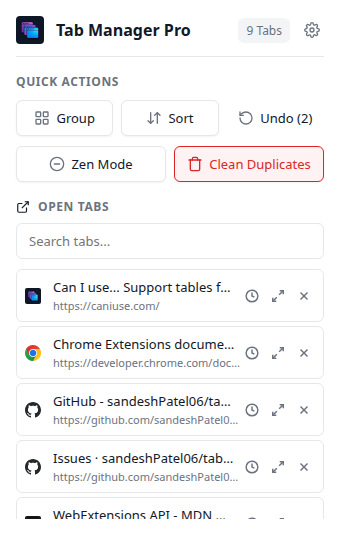
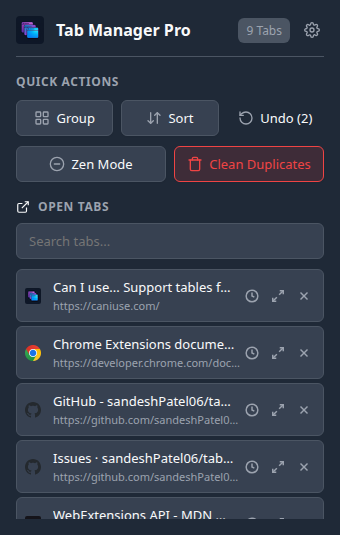
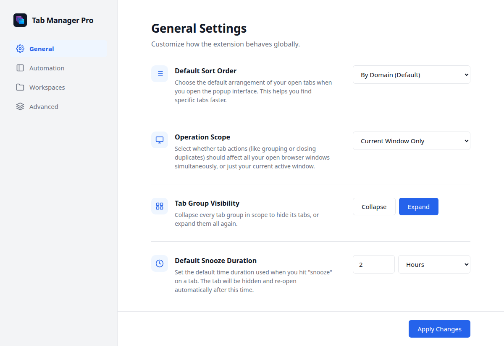
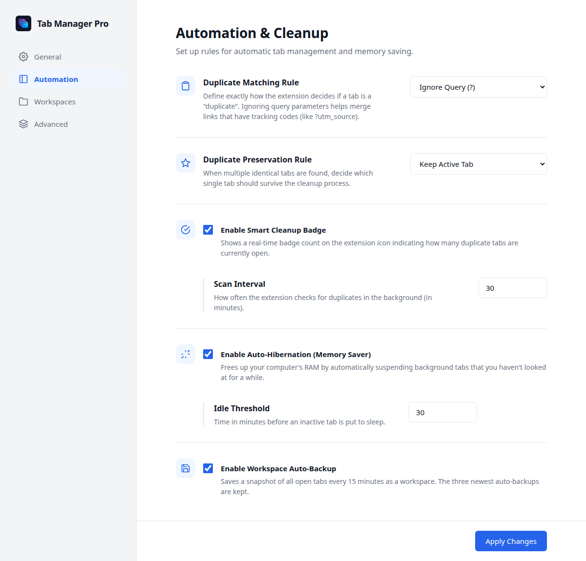
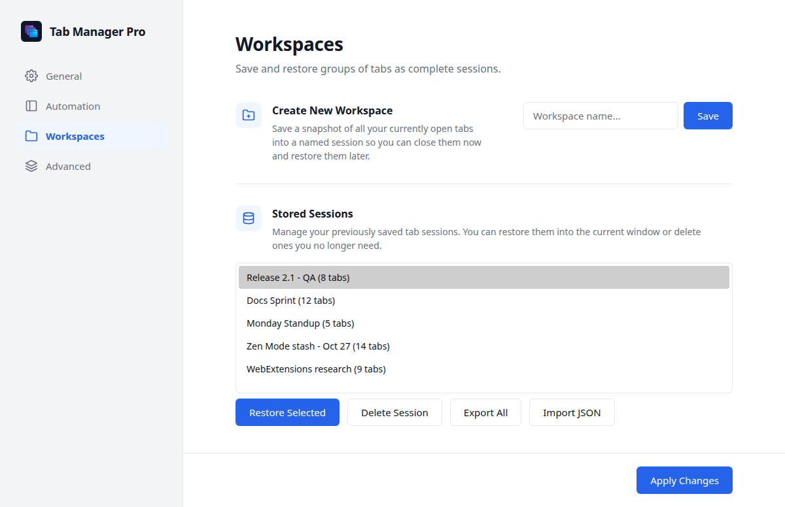
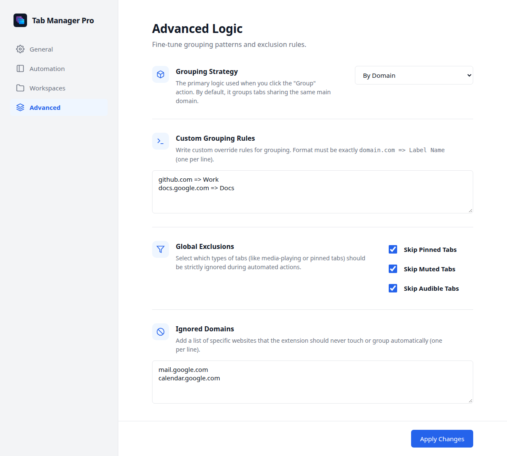

# Tab Manager Pro - Chrome and Firefox Tab Manager Extension

[](https://developer.chrome.com/docs/extensions/develop/migrate/what-is-mv3)
[](LICENSE)
[](#installation)
[](#installation)
[](manifest.json)

**Tab Manager Pro** is a free, open-source Manifest V3 browser extension and tab manager for Chrome, Edge, Brave, and Firefox. It groups tabs by domain, closes duplicate tabs, saves workspace sessions, snoozes distracting tabs, and auto-hibernates inactive tabs to reduce memory usage. Everything runs locally inside your browser: no accounts, analytics, or remote requests.

If you are searching for a **Chrome tab manager**, a **duplicate tab closer**, a **tab session manager**, or a lightweight **memory saver extension**, Tab Manager Pro covers those workflows in one popup.

**Choose your path:**

| I want to... | Start here |
| --- | --- |
| Install and use the extension | [Quick start](#quick-start) · [Installation](#installation) · [FAQ](#faq) |
| Understand how it works | [Architecture](#architecture) · [Project structure](#project-structure) |
| Change or test the code | [Development](#development) · [Manual test checklist](#manual-test-checklist) · [Contributing](#contributing) |

## At a glance

| | |
| --- | --- |
| Product | Free, open-source tab manager browser extension |
| Browsers | Chrome, Edge, Brave (service worker), and Firefox 142+ (event page) |
| Core jobs | Group tabs, close duplicate tabs, save tab sessions, snooze tabs, hibernate idle tabs |
| Storage | Synced settings; local workspaces, undo history, and snooze queue |
| Permissions | `tabs`, `tabGroups`, `storage`, `alarms`, `contextMenus`; no host permissions |
| Network | Fully offline; no telemetry, accounts, analytics, or remote assets |
| License | MIT |

## Table of contents

- [At a glance](#at-a-glance)
- [Quick start](#quick-start)
- [Why Tab Manager Pro](#why-tab-manager-pro)
- [Who it is for](#who-it-is-for)
- [How it compares](#how-it-compares)
- [Screenshots](#screenshots)
- [Features](#features)
- [Keyboard shortcuts](#keyboard-shortcuts)
- [Installation](#installation)
- [Options and configuration](#options-and-configuration)
- [Architecture](#architecture)
- [Project structure](#project-structure)
- [Development](#development)
  - [Regenerating screenshots](#regenerating-screenshots)
- [Manual test checklist](#manual-test-checklist)
- [Packaging and release](#packaging-and-release)
- [Permissions](#permissions)
- [FAQ](#faq)
- [Privacy](#privacy)
- [Contributing](#contributing)
- [License](#license)

## Quick start

### 1. Install the extension

Follow [Installation](#installation). Chrome, Edge, and Brave load the folder as an unpacked extension; Firefox loads `manifest.json` as a temporary add-on.

### 2. Pin it and open the popup

Click the extensions puzzle piece, pin **Tab Manager Pro**, then open it. The popup shows every open tab in the current window or across all windows, depending on your scope setting.

### 3. Clean up duplicates safely

Click **Clean Duplicates**. The extension keeps the tab selected by your preservation rule, closes the rest, and records the batch. Click **Undo** in the popup to restore up to 30 cleanup batches.

### 4. Save your current session

Open **Settings > Workspaces**, name the session, and click **Save**. The workspace stores every eligible tab so you can close the window and restore the set later.

### 5. Tune automation once

In **Settings > Automation & Cleanup**, choose a duplicate matching rule, enable the smart cleanup badge, set an idle threshold for auto-hibernation, and optionally enable workspace auto-backup.

## Why Tab Manager Pro

Too many open tabs slow down your browser, hide the tab you actually need, and consume memory. Tab Manager Pro gives you one place to group tabs, remove duplicate tabs safely (with undo), save a workspace before closing a project, snooze a tab until later, and put idle tabs to sleep through the browser's native discard API.

The extension is built with vanilla JavaScript and no runtime build step. Settings sync through your browser profile, while workspaces and undo history stay in local storage.

## Who it is for

- **Developers** juggling pull requests, API docs, localhost previews, and issue trackers can group tabs by domain and snapshot the whole set as a workspace before switching projects.
- **Students and researchers** can save a reading session, close it, and restore it later without losing sources.
- **Remote workers** can use Zen Mode to stash every background tab before a call and restore the session afterward.
- **Low-memory laptops and Chromebooks** can enable auto-hibernation so inactive tabs release RAM while staying in the tab bar.
- **Privacy-conscious users** get a tab manager that works fully offline with no host permissions and no page-content access.

## How it compares

| Task | Manual browser tabs | Tab Manager Pro |
| --- | --- | --- |
| Group similar tabs | Drag tabs into groups one by one | One click by domain, subdomain, or custom rules |
| Find duplicate tabs | Inspect every URL manually | Configurable matching, preview count, and toolbar badge |
| Undo a cleanup | Reopen closed tabs from history | Up to 30 undo batches |
| Save a project | Bookmarks or scattered notes | Named workspace with JSON export and import |
| Defer a tab | Leave it open | Snooze with automatic restore |
| Free memory | Close tabs and lose state | Discard idle tabs that reload on click |
| Protect important tabs | Remember not to touch them | Pinned, muted, audible, and domain exclusions |

## Screenshots

| Popup: light mode | Popup: dark mode |
| --- | --- |
|  |  |

### General settings



### Automation and memory saver



### Workspace sessions



### Advanced grouping and exclusions



## Features

### Smart tab grouping

- Group tabs by base domain, subdomain, or custom domain-to-label rules such as `github.com => Work`.
- Collapse or expand every group in the current scope from the settings page.
- Groups are created with native browser tab groups and stable colors.

**Try it:** open the popup and click **Group**. Change the strategy in **Settings > Advanced**.

### Duplicate tab cleanup with undo

- Four matching modes: exact URL, ignore hash, ignore query parameters, or domain plus path only.
- Preservation rules: keep the active tab, a pinned tab, or the most recently used tab.
- Right-click a page and choose **Close all duplicates of this tab**.
- Respects the current operation scope and every exclusion rule (pinned, muted, audible, ignored domains).
- Up to 30 undo batches; restore closed tabs from the popup Undo button.
- Optional toolbar badge that counts duplicates in the current scope.

**Try it:** click **Clean Duplicates** in the popup, then click **Undo** to restore the batch.

### Zen Mode

- Stash every eligible background tab into a dedicated workspace and close it in one click.
- Tabs excluded by your rules are left untouched.
- Restore the stash later from **Settings > Workspaces**.

**Try it:** click **Zen Mode** in the popup before a meeting, then restore the workspace afterward.

### Workspace sessions and backups

- Save open tabs from the current window or all windows as a named workspace.
- Restore a session into the current window, or delete sessions you no longer need.
- Export all workspaces to a JSON file and import them on another machine.
- Optional auto-backup snapshots every 15 minutes; the three newest snapshots are retained.

**Try it:** **Settings > Workspaces**, enter a name, and click **Save**.

### Memory saver and auto-hibernation

- Discard inactive tabs after a configurable idle threshold using the browser's native tab discard API.
- Hibernated tabs stay in the tab bar and reload when selected.
- Pinned and audible tabs are skipped.

**Try it:** **Settings > Automation & Cleanup**, enable **Auto-Hibernation**, and set the idle threshold.

### Tab snooze

- Snooze any tab from the popup with the configured default duration (minutes or hours).
- The tab closes immediately and reopens automatically when the alarm fires, even after a browser restart.

**Try it:** click the clock icon on any popup row.

### Search, sorting, and tab indicators

- Debounced search across tab titles and URLs.
- Sort by domain, title, last active time, or pinned-first using your configured default.
- Audible and discarded indicators, plus per-tab Focus, Snooze, and Close actions.

### Privacy and exclusions

- Skip pinned, muted, or audible tabs during automated actions.
- Maintain a domain blocklist for sites the extension must never touch.
- Fully offline: styles, icons, and scripts are bundled locally. No telemetry, tracking, or network calls.

## Keyboard shortcuts

| Shortcut | Action |
| --- | --- |
| `Ctrl + Shift + G` | Group tabs using the current grouping strategy |
| `Ctrl + Shift + D` | Close duplicate tabs using the current rules |
| `Ctrl + Shift + U` | Undo the last duplicate cleanup |

You can remap shortcuts in your browser:

- Chrome, Brave, Edge: `chrome://extensions/shortcuts`
- Firefox: `about:addons` > gear icon > Manage Extension Shortcuts

## Installation

### Chrome, Edge, or Brave

1. Clone the repository:

   ```bash
   git clone https://github.com/sandeshPatel06/tab-manager-pro.git
   ```

2. Open your browser's extensions page:
   - Chrome or Brave: `chrome://extensions`
   - Edge: `edge://extensions`
3. Enable **Developer mode**.
4. Click **Load unpacked** and select the cloned `tab-manager-pro` directory.
5. Pin **Tab Manager Pro** to the toolbar and open the popup.

After changing source files, click the reload icon on the extension card. If the popup reports that it could not load tabs, reload the extension and reopen the popup so the service worker starts again.

### Firefox

Requires Firefox 142 or newer because the manifest targets Manifest V3 with the Firefox event-page fallback.

1. Open `about:debugging#/runtime/this-firefox`.
2. Click **Load Temporary Add-on**.
3. Select [`manifest.json`](manifest.json) inside the project directory.

For a permanent install, package the directory and load it through `about:addons` or publish it on addons.mozilla.org.

## Options and configuration

Open the settings page from the gear icon in the popup, or right-click the extension icon and choose **Options**.

- **General**: default sort order, operation scope (current window or all windows), tab group visibility, and default snooze duration.
- **Automation & Cleanup**: duplicate matching rule, preservation rule, smart cleanup badge, scan interval, auto-hibernation threshold, and workspace auto-backup.
- **Workspaces**: create, restore, delete, export, and import workspace sessions.
- **Advanced Logic**: grouping strategy, custom grouping rules, exclusions (pinned, muted, audible), and ignored domains.

Duplicate cleanup, Zen Mode, and the toolbar badge all follow the configured operation scope and exclusion rules.

## Architecture

The extension has no runtime dependencies and no build step. Popup and settings pages are plain HTML and CSS with ES2022 JavaScript loaded as classic scripts.

```text
popup.html + popup.js ──────┐
options.html + options.js ──┴── runtime.sendMessage ──> background.js
                                                         ├── tabs / tabGroups
                                                         ├── storage.sync / storage.local
                                                         └── alarms / contextMenus
```

- [`background.js`](background.js) owns the message router, alarms, context menus, storage, tab grouping, duplicate planning, workspaces, snooze, and discard.
- The popup and options pages only render state and send messages; the background enforces scope and exclusion rules.
- Cross-browser access goes through a small `browserAPI` wrapper that prefers the promise-based `browser` namespace and falls back to `chrome`.
- The manifest declares both `background.scripts` and `background.service_worker`, so Chrome uses a service worker while Firefox runs an event page.

### Data model

| Storage area | Key | Contents |
| --- | --- | --- |
| `storage.sync` | `settings` | Sort order, scope, matching rules, exclusions, automation preferences |
| `storage.local` | `workspaces` | Named session snapshots with tab URLs and titles |
| `storage.local` | `undoStack` | Up to 30 duplicate-cleanup batches |
| `storage.local` | `snoozedTabs` | Pending snooze entries and restore timestamps |

## Project structure

| Path | Purpose |
| --- | --- |
| [`manifest.json`](manifest.json) | Manifest V3 definition, permissions, commands, and dual background declaration |
| [`background.js`](background.js) | Service worker / event page: messaging, tab operations, storage, alarms |
| [`popup.html`](popup.html), [`popup.js`](popup.js), [`styles.css`](styles.css) | Toolbar popup UI and interaction logic |
| [`options.html`](options.html), [`options.js`](options.js), [`options.css`](options.css) | Full-page settings dashboard |
| [`icons/`](icons) | Toolbar and store icons |
| [`screenshots/`](screenshots) | README screenshots captured from the real UI |
| [`scripts/capture-screenshots.mjs`](scripts/capture-screenshots.mjs) | Playwright script that regenerates the screenshots |
| [`package.json`](package.json) | Dev-only tooling; the extension itself has no runtime dependencies |
| [`LICENSE`](LICENSE) | MIT license text |

## Development

### Prerequisites

- A Chromium browser (Chrome, Edge, Brave, Chromium) or Firefox 142+.
- Node.js 18+ for syntax checks and the optional screenshot tooling.
- No bundler, package manager, or compile step is required to run the extension.

### Edit and reload

1. Open `chrome://extensions` and enable **Developer mode**.
2. Click **Load unpacked** and select this directory.
3. Edit the source files.
4. Click the reload icon on the Tab Manager Pro card, then reopen the popup.

Debugging tips:

- Inspect the service worker from the **service worker** link on the extension card.
- Right-click the popup and choose **Inspect** to open DevTools for the popup page.
- Run `chrome.storage.sync.clear()` and `chrome.storage.local.clear()` in the service worker console to reset settings and saved sessions.
- On Firefox, inspect the background event page from `about:debugging`.

### Syntax checks

```bash
node --check background.js
node --check popup.js
node --check options.js
node --check scripts/capture-screenshots.mjs
```

### Regenerating screenshots

The screenshots in this README are generated from the actual extension UI with Playwright:

```bash
npm install
npx playwright install chromium
npm run screenshots
```

The script launches Chromium with the unpacked extension, opens demo tabs, seeds settings and workspaces into a temporary browser profile, captures the popup and each settings page, and deletes the temporary profile afterward. It does not touch your daily browser profile. Set `HEADED=1` to watch the capture:

```bash
HEADED=1 npm run screenshots
```

Output files are written to [`screenshots/`](screenshots):

| File | View |
| --- | --- |
| `popup.png` | Popup in light mode |
| `popup-dark.png` | Popup in dark mode |
| `options.png` | General settings |
| `automation.png` | Automation and memory saver |
| `workspaces.png` | Workspace manager |
| `advanced.png` | Advanced grouping and exclusions |

## Manual test checklist

| Area | What to verify |
| --- | --- |
| Grouping | Group by domain, subdomain, and custom rule; collapse and expand from Settings |
| Duplicates | Each matching mode, each preservation rule, and exclusion rules leave protected tabs open |
| Undo | Cleanup batches restore tab URLs, pinned state, and reach the 30-batch limit correctly |
| Workspaces | Save from current and all-window scope; restore, delete, export, and import JSON |
| Snooze | Snoozed tab closes immediately and reopens when the alarm fires; queue survives restart |
| Auto-hibernation | Idle tabs discard, remain in the tab bar, and reload on selection; pinned and audible tabs stay active |
| Scope | Current-window and all-window actions touch only the expected tabs |
| Firefox | Temporary add-on loads, promise-based APIs resolve, and the background event page stays alive |

## Packaging and release

1. Bump the version in [`manifest.json`](manifest.json) and [`package.json`](package.json).
2. Create a zip containing only runtime files:

   ```bash
   zip -r tab-manager-pro-2.1.0.zip manifest.json background.js popup.html popup.js options.html options.js styles.css icons LICENSE README.md
   ```

3. Upload the zip to the Chrome Web Store and/or addons.mozilla.org, or keep loading the unpacked folder for local use.

Do not include `node_modules/`, `.git/`, or local browser profiles in the package. The screenshot script is development tooling and is not required at runtime.

## Permissions

| Permission | Why it is needed |
| --- | --- |
| `tabs` | Query, move, group, discard, snooze, and close tabs. |
| `tabGroups` | Create tab groups, set titles and colors, and collapse or expand them. |
| `storage` | Sync settings and store workspaces, undo history, and snoozed tabs locally. |
| `alarms` | Schedule snooze reminders, auto-hibernation scans, cleanup badge scans, and optional backups. |
| `contextMenus` | Add the right-click duplicate cleanup action. |

Tab Manager Pro requests no host permissions and does not read page content.

## FAQ

### How do I close duplicate tabs in Chrome?

Open the Tab Manager Pro popup and click **Clean Duplicates**, or right-click a page and choose **Close all duplicates of this tab**. Choose a matching rule and preservation rule in Settings first. Every cleanup can be undone for up to 30 batches.

### Does it work in Firefox?

Yes. The manifest includes a Firefox event-page fallback and the code uses the promise-based WebExtension API. Firefox 142 or newer is required by the included manifest settings.

### Does Tab Manager Pro work offline?

Yes. Styles, icons, and scripts ship with the extension, and the interface uses your system font. There are no analytics, remote fonts, CDN assets, or network requests.

### How do I reduce Chrome memory usage with tabs?

Enable **Auto-Hibernation** under Automation & Cleanup and set an idle threshold. Inactive tabs are discarded using the browser's native discard API; they remain visible in the tab bar and reload when selected.

### Where are my workspaces and settings stored?

Settings use synchronized browser storage. Workspaces, snoozed tabs, and undo history use local storage. Use **Export All** on the Workspaces page to create a JSON backup you can import elsewhere.

### The popup says it could not load tabs. What should I do?

Reload the extension from `chrome://extensions` (or `about:debugging` in Firefox) and reopen the popup. This restarts the background service worker. If it persists, inspect the service worker console for errors before opening an issue.

### Is it free and open source?

Yes. Tab Manager Pro is released under the MIT License.

### What is a tab manager extension?

A tab manager extension is a browser add-on that helps you organize, search, and clean up open tabs. Tab Manager Pro combines tab grouping, duplicate tab removal, workspace sessions, tab snooze, and memory-saving tab hibernation in a single extension instead of five separate tools.

### Can I group tabs automatically in Chrome or Firefox?

Yes. Choose a grouping strategy by base domain, subdomain, or custom domain-to-label rules, then click **Group** in the popup. Tab Manager Pro creates native browser tab groups and can collapse or expand them from the settings page.

### How is this different from built-in tab groups?

Built-in browser tab groups only organize tabs. Tab Manager Pro adds duplicate detection with undo, saved workspace sessions with JSON import/export, tab snooze, idle-tab hibernation, exclusion rules, and a duplicate-count badge while still using native tab groups.

### Does it read page content or browsing history?

No. Tab Manager Pro requests no host permissions and injects no content scripts. It uses the `tabs` permission for open-tab metadata such as title and URL, and all data stays in your browser.

## Privacy

Tab Manager Pro does not collect, transmit, sell, or share data. It has no server component, no analytics, and no advertising. All tab data stays inside your browser profile. The only optional network-adjacent behavior is your browser's own sync service for synchronized settings.

## Contributing

Contributions are welcome.

1. Fork the repository and create a branch for your change.
2. Keep the extension dependency-free at runtime and use the existing `browserAPI` wrapper for cross-browser calls.
3. Render tab data with `textContent` or DOM APIs rather than string-built HTML.
4. Run the syntax checks and the [manual test checklist](#manual-test-checklist).
5. Regenerate screenshots if you change the popup or settings UI.
6. Open a pull request with the browser and version you tested.

For bug reports, include your browser version, reproduction steps, and any service worker or popup console errors.

## License

MIT License. See [LICENSE](LICENSE) for the full text.

Copyright (c) 2026 Sandesh Patel.
